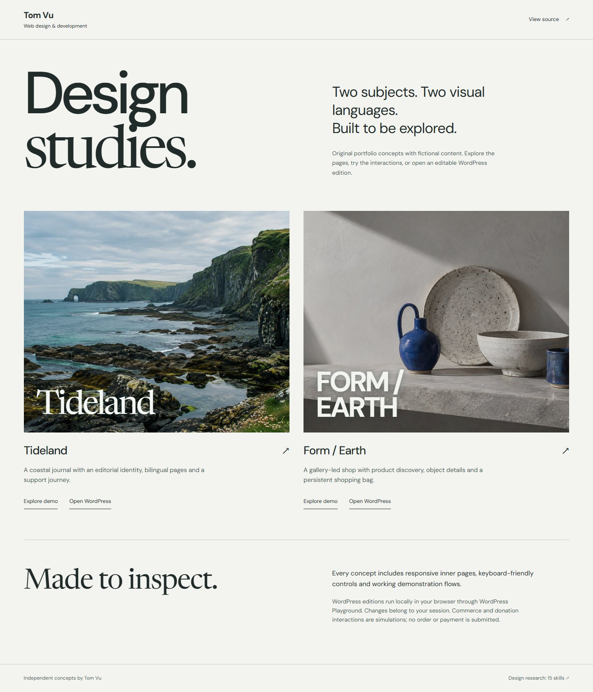

# Design studies by Tom Vu

Two original, responsive portfolio concepts with fictional content and generated editorial imagery.

- **Tideland:** coastal editorial website, English/Polish switching, searchable journal, four article variants and a simulated support journey.
- **Form / Earth:** ceramics commerce concept, filterable collection, four product details, finish choices and a persistent shopping bag with a simulated checkout.

The demos are personal portfolio work, not client case studies. No payment, order, email or donation is sent. Form / Earth demonstrates commerce interactions; it is not a WooCommerce integration.

## Explore

[Hosted instant preview](https://tom-vu-design-studies.sillybell65.chatgpt.site) is owner-private. The WordPress launch links below are public.

Run `node scripts/serve.mjs`, then open <http://127.0.0.1:4185/>. The static pages need no build step or runtime dependencies.

Real WordPress editions are generated from the same pages and assets with `node scripts/build-wordpress.mjs`. They use a small custom theme and native Pages whose main content can be edited in Custom HTML blocks. The visual shell and interaction code live in the theme. WordPress runs inside the visitor's browser through [WordPress Playground](https://developer.wordpress.org/playground/); it needs an internet connection and an initial runtime download. Changes are local to the session.

- [Launch Tideland in WordPress](https://playground.wordpress.net/?blueprint-url=https%3A%2F%2Fraw.githubusercontent.com%2Ftomlemur57-ux%2FDemoWebsites%2Fmain%2Fdist%2Fwordpress%2Ftideland.json)
- [Launch Form / Earth in WordPress](https://playground.wordpress.net/?blueprint-url=https%3A%2F%2Fraw.githubusercontent.com%2Ftomlemur57-ux%2FDemoWebsites%2Fmain%2Fdist%2Fwordpress%2Fform-earth.json)

## Verify

Install development dependencies with `npm install`, install the QA browser with `npx playwright install chromium`, start the preview, then run `npm test`. Browser checks cover the nine static pages at desktop, tablet and phone sizes, navigation, language switching, filters, article variants, form validation, product routes and the bag lifecycle. Run `node scripts/verify-wordpress.mjs` for the separate WordPress runtime checks. See [VALIDATION.md](VALIDATION.md) for the verified scope.

## Design sources

[DESIGN-RESEARCH.md](DESIGN-RESEARCH.md) documents 15 primary-source design skills, their practical guidance and limitations. They were researched and selectively applied; no remote skill code was installed or executed.

## Assets and scope

All depicted brands, products, article scenarios, sample prices, stock states and organisations are fictional. Editorial images were generated specifically for these studies. Fonts load from Google Fonts. No private buyer designs, assets, credentials or project materials are included.

## Native WooCommerce edition

A separate FORM / EARTH edition adds four native WooCommerce variable products, eight finishes, a session cart and fictional test orders. The original static and WordPress editions remain available.

Build with `npm run build:woocommerce`, then open `wordpress.html?site=form-earth-woocommerce` through the local preview. Its Blueprint is `dist/wordpress/form-earth-woocommerce.json`. The official WooCommerce 11.2.1 download requires WordPress 7.0 or newer; this separate Blueprint pins the verified WordPress 7.1.3 and PHP 8.3 runtime. It does not change the older editions pinned to WordPress 6.8.

Checkout uses a fixed fictional identity, an offline demonstration gateway, and no shipping or fulfillment. Outgoing email is disabled. No payment provider, live customer data, merchant account or real order is connected. Data belongs to the temporary Playground session; persistence after a reload is not promised. This is a personal demonstration, not a client case study.
